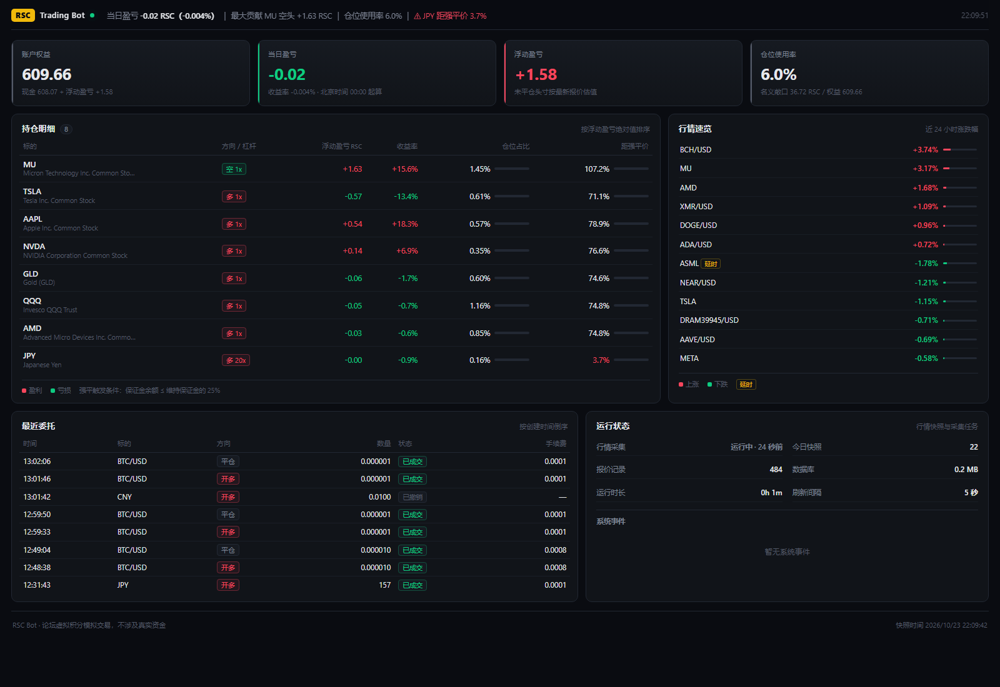

<div align="center">

# RSC Bot

**Riverside 虚拟交易所自动化交易系统 · Docker 部署 · 内置监控台**


[快速开始](#-快速开始) · [监控台](#-监控台) · [配置](#-配置) · [文档](#-文档)

</div>



## 📌 概述

RSC Bot 是一个面向 [river-side.cc](https://river-side.cc/rsc/market) 虚拟交易所的自动化交易系统，覆盖行情采集、策略计算、风险控制、订单执行与实时监控的完整链路。

- **标的范围** — 外汇（久留美活动）、加密货币、港股、美股、A 股、欧股、日股、新加坡股票、贵金属与指数，共 1638 个标的
- **交易标的** — 论坛积分 RSC；模拟盘，不涉及真实资金
- **运行方式** — 单机 Docker Compose 部署，对外暴露监控台端口 `8001`

## ✨ 特性

| 能力 | 说明 |
|---|---|
| **分钟级交易链路** | 行情快照间隔 60s；全站限频 30 req/min，客户端令牌桶按优先级调度，预留突发余量 |
| **交易所规则适配** | 杠杆上限、净持仓约束、最小下单量、休市状态、报价时效、强平价校验在下单前完成 |
| **幂等执行** | 所有写操作携带 `request_id`，网络超时重试不会产生重复委托 |
| **风险前置** | 高杠杆保证金预算、单日亏损上限、强平距离监控 |
| **监控台** | 权益、当日盈亏、浮动盈亏、仓位使用率、强平距离、委托流水、系统健康 |
| **单文件存储** | SQLite（WAL），无外部服务依赖，可直接用 pandas / DuckDB 分析 |
| **容器化部署** | 国内镜像源开箱可用，端口与数据目录可配置 |

## 📰 News

- 🚀 **2026-10-23** — 项目初始化。交易所契约实测完成：下单、平仓、保护单、撤单的幂等语义与 9 类业务错误码已验证。
- 📡 **2026-10-23** — 行情采集器上线，60s 增量快照落库，支持全量元数据定时刷新。
- 📊 **2026-10-23** — 监控台 v0.1 发布，提供持仓、委托、行情与系统健康视图。
- 🐳 **2026-10-23** — Docker 镜像与 Compose 编排就绪，支持局域网访问。
- 🧭 **2026-10-24** — 数据管道 v0.2：自选池 60 标的（10 类市场）5 分钟 K 线 + 1 小时/日线回补落库；补上日志轮转、WAL checkpoint 与数据库体积统计。

## 🚀 快速开始

### 1. 准备

```bash
git clone https://github.com/AndingDrLin/RSC-bot.git
cd RSC-bot
cp .env.example .env
```

编辑 `.env`，填入账号密码。登录须使用**邮箱**，中文用户名会被服务端拒绝（HTTP 400）：

```ini
RSC_EMAIL=you@example.com
RSC_PASSWORD=your-password
```

### 2. 启动

```bash
docker compose up -d --build
```

### 3. 访问

```
http://<主机IP>:8001
```

首次启动会拉取一次全量快照（约 3.4 MB），随后按 60s 周期采集热门池；自选池（`config/watchlist.json`，默认 60 个标的）每 5 分钟补一次 5m K 线，并异步回补 1 小时/日线。数据持久化在宿主机 `./data/`。

### 本地开发

```bash
pip install -i https://pypi.tuna.tsinghua.edu.cn/simple -r requirements.txt

export PYTHONPATH=src
python -m rscbot.collector                                          # 采集器
python -m uvicorn rscbot.web.app:app --host 0.0.0.0 --port 8001     # 监控台
```

## 📊 监控台

| 区域 | 指标 |
|---|---|
| 状态栏 | 当日盈亏、最大贡献/拖累持仓、仓位使用率、强平预警 |
| 核心指标 | 账户权益 / 当日盈亏 / 浮动盈亏 / 仓位使用率 |
| 持仓明细 | 方向与杠杆、浮动盈亏、收益率、仓位占比、**距强平价** |
| 行情速览 | 涨幅榜与跌幅榜，延时品种标注 |
| 委托记录 | 时间、标的、方向、数量、状态、手续费 |
| 运行状态 | 采集心跳、快照数量、存储大小、系统事件 |

数据视图每 5 秒轮询 `/api/summary`，不直接请求交易所接口，避免占用交易限频额度。

### 数据管道

`collector` 在一轮循环里分层取数，总预算 ≤ 25 req/min（服务端上限 30）：

| 层级 | 数据 | 频率 | 额度 |
|---|---|---|---|
| Tier A 热门池 | `state.json?section=market` → `quotes` | 60s | 1/min |
| Tier B 自选池 | `history.json?range=1d` → `bars`（5m）+ 看板报价 | 5min × 60 标的 | ~12/min |
| Tier C 回补 | `history.json?range=5d\|1y` → `bars`（1h / 日线） | 启动时或数据过期后 | 剩余额度 |
| 元数据 | `state.json` 全量 → `instruments` | 30min | 1/30min |

自选池在 [config/watchlist.json](config/watchlist.json) 配置（`symbols` 数组、`interval_s`、`backfill` 过期阈值），改完重启 collector 生效。
`bars` 表主键 `(instrument_id, rng, ts)`：`rng` 记录来源 range（`1d`=5m、`5d`=1h、`1y`=日线），`ts` 统一 UTC epoch 秒，幂等重写。

## ⚙️ 配置

| 变量 | 默认值 | 说明 |
|---|---|---|
| `RSC_EMAIL` | — | 登录邮箱（必填） |
| `RSC_PASSWORD` | — | 登录密码（必填） |
| `RSC_BASE_URL` | `https://river-side.cc` | 站点地址 |
| `RSC_DB` | `data/market.db` | SQLite 路径；容器内为 `/app/data/market.db` |
| `RSC_PER_MINUTE` | `25` | 客户端限频上限，服务端为 30 |
| `RSC_TIMEOUT_S` | `60` | 单请求超时（秒） |
| `RSC_WATCHLIST` | `config/watchlist.json` | 自选池配置文件路径（collector 与 web 共用） |
| `BASE_IMAGE` | `docker.m.daocloud.io/library/python:3.12-slim` | 构建基础镜像，海外可改为 `python:3.12-slim` |
| `PIP_INDEX` | 清华源 | pip 镜像 |
| `APT_MIRROR` | 阿里云 | Debian 镜像 |

## 🏗 架构

```
┌──────────────┐   60s    ┌──────────────┐
│  collector   │ ───────▶ │  market.db   │
│  行情采集     │          │   SQLite     │
└──────────────┘          └──────┬───────┘
                                 │ 只读
┌──────────────┐  30 req/min     │
│  RSC 交易所   │ ◀───────────────┤
└──────────────┘                 ▼
                          ┌──────────────┐
                          │  web /api    │
                          │    :8001     │
                          └──────────────┘
```

技术栈：Python 3.12 · FastAPI · SQLite (WAL) · vanilla JS · Docker Compose。

## 🗺 Roadmap

- [x] **M0** 交易所契约实测（认证、下单、撤单、保护单、错误码）
- [x] **M1** 行情采集与本地存储
- [ ] **M2** 因子库与策略引擎
- [ ] **M3** 组合构建与风险控制
- [ ] **M4** 订单执行器与成交确认
- [ ] **M5** 回测框架与成本模型校准
- [ ] **M6** 监控告警与运维 Runbook
- [ ] **M7** 实盘灰度与稳定性验证

## 📚 文档

| 文档 | 内容 |
|---|---|
| [交易所契约](docs/01-exchange-contract.md) | 认证、接口、下单参数、错误码字典、交易规则、数据模型 |
| [系统架构](docs/02-architecture.md) | 拓扑、模块边界、限频预算、存储 schema |
| [开发计划](docs/03-development-plan.md) | M0–M7 里程碑与任务拆解 |
| [测试与验收](docs/04-test-and-acceptance.md) | 测试金字塔、黄金用例、故障注入、上线门槛 |
| [策略与回测](docs/05-strategy-and-backtest.md) | 策略族、因子库、walk-forward、成本模型 |
| [研究方法](docs/09-research-basis.md) | 文献与开源参考、策略验证路径、频率边界 |
| [部署运维](docs/07-deploy-ops-security.md) | 监控、告警、备份、Runbook |

## ⚖️ 免责声明

本项目用于论坛虚拟积分 RSC 的模拟交易与工程实践，不构成投资建议，不涉及真实资金。使用风险自负。

## 📄 License

[MIT](LICENSE) © 2026 AndingDrLin
