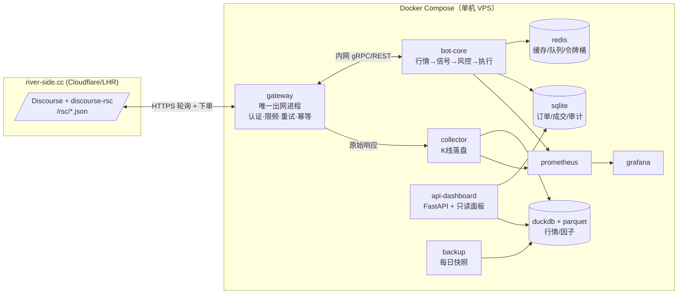
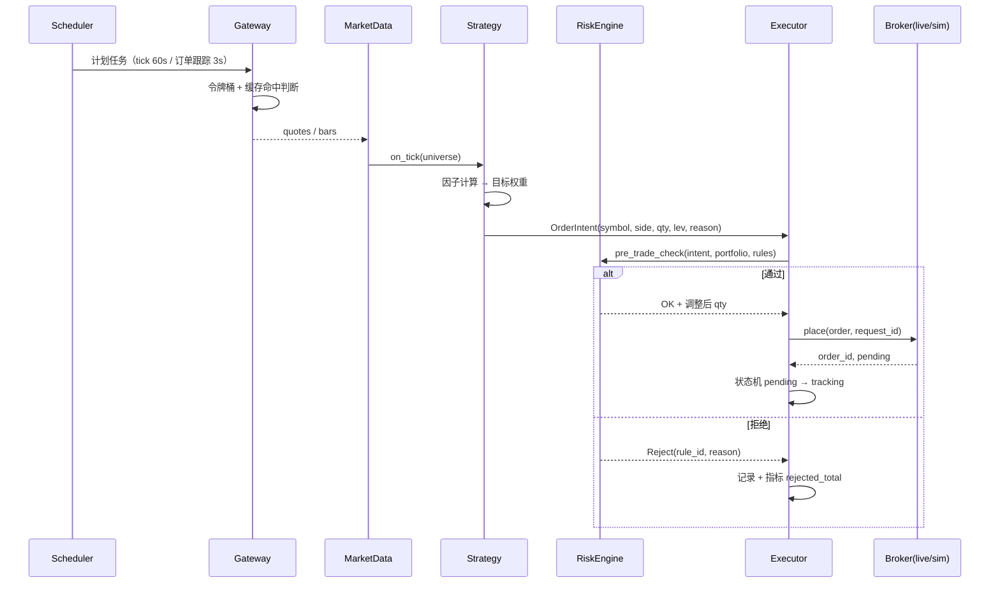

# 02 · 系统架构设计

**设计原则**：单账户、低吞吐（每秒 < 1 单）、强约束（30 请求/分钟）→ **不要微服务**。用"单进程事件驱动 + 单一出网网关 + 可替换的 Broker"换取确定性、可测试性和低运维成本。

---

## 1. 架构总览



**关键点：只有一个进程能出网。** 所有 `/rsc/*` 请求走 `gateway`，由它统一持有：
- 登录会话与自动重登
- 全局令牌桶（30 次/分钟，按优先级分配）
- 重试/退避/幂等（`request_id`）
- 响应缓存（同一 tick 内相同请求只打一次）

这样即使 collector、core、dashboard 各自想拉数据，也不可能击穿限频。这是本架构最重要的决定（ADR-001）。

---

## 2. 进程与容器

| 服务 | 职责 | 资源 | 重启策略 |
|---|---|---|---|
| `gateway` | 认证、HTTP 客户端、限频、缓存、请求路由 | 0.3 CPU / 256 MB | always |
| `bot-core` | 调度器、策略、风控、执行、对账 | 0.5 CPU / 512 MB | always |
| `collector` | 按计划拉 K 线、落 Parquet、数据质量检查 | 0.3 CPU / 512 MB | always |
| `dashboard` | 只读监控页 + `/healthz` + `/metrics` | 0.1 CPU / 128 MB | always |
| `redis` | 缓存、进程间队列、分布式令牌桶 | 128 MB | always |
| `prometheus` + `grafana` | 指标、看板、告警 | 0.3 CPU / 512 MB | always |
| `backup` | 每日 03:00 UTC 打包 DuckDB/SQLite 到对象存储或本地 | 0.05 CPU | 定时 |
| `mock-exchange` | **仅测试/开发**，模拟交易所（含故障注入） | 0.1 CPU | profile: test |

> 为什么 collector 独立：采集是"可丢可重放"的，交易是"不可重放"的。采集拖慢或崩溃不应影响持仓管理。

---

## 3. 模块边界（`src/rscbot/`）

```
exchange/          # E1
  session.py       #   登录、CSRF、cookie 持久化、自动重登
  client.py        #   高层 API：state/history/order/cancel/protection/ranking
  gateway.py       #   限频、重试、幂等、缓存、请求队列（唯一出网点）
  models.py        #   pydantic：Instrument/Quote/Position/Order/Wallet
  errors.py        #   错误码映射（400/409/422/429/5xx → 领域异常）
  ratelimit.py     #   令牌桶 + 优先级 + Redis 后端

marketdata/        # E2
  poller.py        #   分层轮询调度（Tier A/B/C）
  store.py         #   Parquet 分区写入 + DuckDB 视图
  bars.py          #   5m/1h/1d K 线重建与校验
  calendar.py      #   开闭市时间（读 quote.session_*，含 DST）
  quality.py       #   缺口、跳变、时间倒流检测

backtest/          # E3
  matcher.py       #   撮合模型（费用/滑点/确认延迟/5% 拒单/强平）
  broker_sim.py    #   实现 Broker 协议的内存撮合器
  portfolio.py     #   保证金、权益、强平计算（与交易所公式一致）
  engine.py        #   事件驱动回放
  metrics.py       #   Sharpe/Sortino/Calmar/MaxDD/换手/费用占比

strategy/          # E4
  base.py          #   Strategy 协议：on_start/on_bar/on_quote/on_fill
  factors/         #   因子库（动量、反转、波动、价差、跨市场）
  universe.py      #   标的池构建与过滤（流动性、时段、延迟标记）
  allocator.py     #   信号 → 目标权重
  families/        #   策略族：trend / meanrev / xsec / pairs / event

execution/         # E5
  intent.py        #   目标权重 → 订单意图（含最小步长、名义下限）
  router.py        #   意图 → 实际下单（拆单、择时、幂等）
  tracker.py       #   订单状态机 + 成交确认 + 超时处理
  reconcile.py     #   日终对账（本地账本 vs state.json）

risk/              # E5
  rules.py         #   rules.yaml 驱动的前置校验
  limits.py        #   集中度、杠杆、单日亏损、相关性
  circuit.py       #   熔断器（连续亏损、异常波动、限频逼近）

portfolio/         # E6
  budget.py        #   保证金预算（含 high_risk 25% 专项）
  weights.py       #   风险平价 / 波动率目标 / 约束优化

obs/               # E7
  logging.py       #   structlog JSON，trace_id 贯穿
  metrics.py       #   Prometheus 指标定义
  alerts.py        #   告警规则与降噪
  audit.py         #   不可篡改审计流（append-only JSONL + 哈希链）
```

---

## 4. 请求预算：30 次/分钟怎么花

这是本系统最稀缺的资源，必须显式调度。

| 优先级 | 用途 | 预算（次/分） | 说明 |
|---|---|---|---|
| P0 | 下单/撤单/保护单 | 6 | 留足余量，突发时抢占 |
| P1 | 成交确认轮询 | 8 | 下单后 3 s × 10 次，仅在有 pending 时消耗 |
| P2 | 热点行情（Tier A，≤10 标的） | 10 | 60 s 一轮 |
| P3 | 自选池轮转（Tier B，30–60 标的） | 4 | 5 分钟一轮，round-robin |
| P4 | 采集补齐（collector） | 2 | 收盘后补历史 |

合计 30。`gateway` 用 Redis 令牌桶实现跨进程共享，任何请求拿不到令牌就进入队列等待（带 deadline），到期丢弃并记 `budget_starved` 指标。

**反例（必须避免）**：每 tick 拉一次全量 `state.json`（3.4 MB / 4.4 s）—— 10 分钟就用完一小时的额度。

---

## 5. 主事件流



策略只产出**意图**，不直接下单；执行层独占下单权。这样回测时可以替换 Broker，实盘时保留完整审计。

---

## 6. 存储设计

### 6.1 行情（DuckDB + Parquet）

```
data/quotes/exchange=HKEX/date=2026-10-23/part-*.parquet
  ts_utc, instrument_id, symbol, bid, ask, last, local_price, fx_rate,
  delay_seconds, source, session_state

data/bars/timeframe=5m/exchange=HKEX/date=2026-10-23/part-*.parquet
  ts_utc, instrument_id, open, high, low, close, volume, src(range), quality_flag

data/factors/date=2026-10-23/factors.parquet
  ts_utc, instrument_id, factor_name, value, version
```

分区键：`exchange/date`（查询模式以市场和日期为主）。DuckDB 建视图 `v_bars_5m` 统一查询。

**保留策略**：quotes 30 天（约 1638 × 1440 × 30 ≈ 7000 万行，压缩后 ~2 GB）；bars 永久；factors 180 天。

### 6.2 交易（SQLite，WAL）

```sql
orders(id PK, request_id UNIQUE, instrument_id, symbol, side, quantity, leverage,
       status, price, fee, margin, pnl, created_at, updated_at, raw_json)
fills(order_id, fill_seq, price, fee, qty, ts, reference_price)
positions_snapshot(ts, instrument_id, qty, avg, margin, equity, liq_price)
account_snapshot(ts, balance, reserved, equity, margin)
decisions(id, ts, symbol, action, reason, factors_json, risk_verdict, order_id)
audit(id, ts, actor, action, payload_hash, prev_hash)   -- 哈希链
```

**为什么是 SQLite 而不是 Postgres**：单写者、< 100 行/分钟、需要"文件即备份"。运维成本几乎为零，pg_dump 的复杂度不值得。

### 6.3 Redis

| Key | 用途 | TTL |
|---|---|---|
| `rl:tokens:{class}` | 令牌桶计数 | 60 s |
| `cache:state:market` | market 段快照 | 30 s |
| `cache:quote:{id}` | 单标的报价 | 60 s |
| `q:orders` | 待执行意图队列 | — |
| `lock:{instrument}` | 单标的互斥（防重复下单） | 10 s |

---

## 7. 关键技术决策（ADR 摘要）

| ID | 决策 | 备选 | 理由 |
|---|---|---|---|
| ADR-001 | 单一出网网关 | 各服务直连 | 30 次/分钟是全局限额，必须集中调度，否则必然超限 |
| ADR-002 | Python 3.12 + asyncio | Rust/Go | 瓶颈是网络与 60 s tick，不是 CPU；生态（pandas/polars/qlib）决定研究速度 |
| ADR-003 | 单进程 bot-core | 微服务 | 单账户、状态强一致（持仓/保证金），分布式只会引入不一致 |
| ADR-004 | DuckDB + Parquet | Postgres/Timescale | 分析型负载、单机、零运维、单文件备份 |
| ADR-005 | SQLite 记录交易 | Postgres | 写入量极低，WAL 足够，备份 = 拷文件 |
| ADR-006 | 策略只产意图 | 策略直接下单 | 回测/实盘同构，风控唯一入口，审计完整 |
| ADR-007 | 自建 Paper Broker | 交易所 demo 账户 | 交易所无 demo 模式（`demo:false`），只能内部仿真 |
| ADR-008 | 配置 YAML + pydantic | 纯环境变量 | 规则/参数需要版本化 diff 与评审 |
| ADR-009 | 时钟/HTTP 可注入 | 直接调用 | 回测与故障注入的前提 |
| ADR-010 | 结构化日志 + trace_id | print | 事后复盘的唯一依据 |

---

## 8. 非功能指标（NFR）

| 指标 | 目标 | 测量方式 |
|---|---|---|
| tick 端到端延迟（报价→意图） | P95 < 5 s | `tick_duration_seconds` 直方图 |
| 下单延迟（意图→交易所 200） | P95 < 2 s | `order_submit_seconds` |
| 持仓状态新鲜度 | ≤ 90 s | `position_age_seconds` |
| 日可用性 | ≥ 99.5% | uptime + 心跳 |
| 内存峰值 | < 1 GB | cgroup 指标 |
| 冷启动到可交易 | < 30 s | 启动探针 |
| 故障恢复 RTO | < 5 min | 演练记录 |
| 数据丢失 RPO | ≤ 1 min（交易）/ 1 天（行情） | 备份校验 |
| 镜像大小 | < 500 MB | CI 检查 |

---

## 9. 配置体系

```yaml
# config/strategy.example.yaml（节选）
universe:
  mode: explicit          # explicit | filter
  include: [FX:JPY, CRYPTO:BTC/USD, NASDAQ:NVDA, HKEX:0700]
  exclude_delayed: true   # 排除 15 分钟延迟品种
risk:
  max_gross_leverage: 3.0
  max_symbol_weight: 0.25
  max_daily_loss_pct: 5.0
  high_risk_budget_ratio: 0.25
execution:
  order_type: market
  max_slippage_bps: 20
  fill_timeout_s: 60
```

- 三层优先级：**代码默认 < YAML 文件 < 环境变量**（12-factor）。
- 所有密钥只在环境变量（`.env`，已 gitignore），且日志层做 `SecretStr` 掩码。
- 配置变更需重启（拒绝热更新，避免"实盘中悄悄换了参数"这种事故）。

---

## 10. 可测试性设计（写进架构，而不是事后补）

| 机制 | 用途 |
|---|---|
| `Clock` 注入 | 回测用虚拟时钟推进，实盘用 `datetime.now(UTC)` |
| `Transport` 注入 | 单元测试用 `respx` 拦截 httpx，契约测试用录制回放 |
| `Broker` 协议 | `LiveBroker` / `PaperBroker` / `ReplayBroker` 三实现 |
| `Strategy` 协议 | 回测与实盘同一份策略代码，禁止 `if backtest:` 分支 |
| 事件日志 | 每个决策写 `decisions` 表，可离线重放 |
| 故障注入 | mock-exchange 支持：429 / 503 / 慢响应 / 部分成交 / 5% 漂移 / 休市 |

> 铁律：**回测与实盘必须走同一条代码路径**，差异只允许出现在 `Broker` 和 `Clock` 两个实现上。违反这条的项目，回测数据一律不可信。
