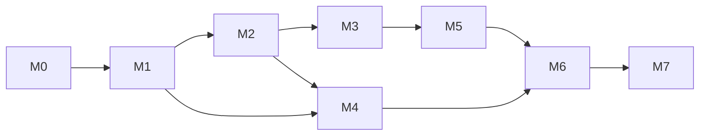

# 03 · 开发计划与里程碑

**排期假设**：1 名主程（全职）+ 0.5 名策略研究（兼职），共 8 周 ≈ 60 人日。若只有 1 人，压缩策略研究阶段（M5 降级为"复现 + 单族策略"），总周期 10 周。

任务编号 `M{x}-T{y}` 在 [04 测试与验收](04-test-and-acceptance.md) 中被逐条引用——**每个任务都必须有对应验收项，否则不算完成**。

---

## 0. 工程环节总览（E0–E8）

| 环节 | 名称 | 对应里程碑 | 产出物 |
|---|---|---|---|
| E0 | 基础设施与规范 | M0 | 仓库、CI、Docker、配置、mock 交易所 |
| E1 | 交易所客户端 SDK | M1 | `exchange/`，可独立 pip 安装的客户端 |
| E2 | 行情数据管道 | M2 | `marketdata/`，Parquet 数据集 |
| E3 | 回测与仿真引擎 | M3 | `backtest/`，可复现研究报告 |
| E4 | 策略与组合 | M5 | `strategy/`，因子库、策略族 |
| E5 | 执行与风控 | M4 | `execution/`、`risk/`，订单状态机 |
| E6 | 资金与保证金管理 | M4/M5 | `portfolio/` |
| E7 | 可观测与运维 | M7 | `obs/`、Grafana、Runbook |
| E8 | 研究流程与实验管理 | M5 | 实验台账、模型卡 |

依赖关系（关键路径）：

**并行机会**：M2（数据）与 M1（SDK）可由第二人并行；M3（回测）与 M4（执行）在 M2 完成后并行。

---

## 1. M0 · 契约冻结与基础设施（W1，5 人日）

### 目标
把"交易所怎么用"变成可执行的代码契约，把"工程怎么跑"变成一条命令。

### 任务

| ID | 任务 | 产出 | 估时 |
|---|---|---|---|
| M0-T1 | 仓库骨架：`pyproject.toml`(uv)、ruff、mypy、pytest、pre-commit | 可 `make lint test` | 0.5 |
| M0-T2 | Docker 化：多阶段 Dockerfile、compose、healthcheck、资源限制 | `docker compose up` 起全链路 | 1.0 |
| M0-T3 | `mock-exchange`：FastAPI 假交易所，覆盖 state/order/cancel/history + 故障注入开关 | 测试可离线跑 | 1.5 |
| M0-T4 | 契约基线：录制真实响应（登录/state/history/order/cancel）为 fixtures | `tests/contract/fixtures/*.json` | 0.5 |
| M0-T5 | `config/rules.yaml`：把 [01](01-exchange-contract.md) 的规则字典化 + JSON Schema | 规则可校验 | 0.5 |
| M0-T6 | 可观测骨架：structlog、Prometheus 指标、`/healthz`、trace_id | 日志/指标可查 | 0.5 |
| M0-T7 | 安全基线：`.env.example`、`.gitignore`、gitleaks、密钥不落日志的单测 | CI 拦截泄漏 | 0.5 |

### 已完成（2026-10-23，真实账户实测）

| 任务 | 状态 | 证据 |
|---|---|---|
| M0-T4 契约基线 | **部分完成** | `probes/contract_probe.py` → `probes/results.json`（15 用例）；`probes/probe2-5.py` 补齐幂等/撤单/保护单；结论已回写 [01 §3.8](01-exchange-contract.md) |
| M0-T5 rules.yaml | **完成** | [config/rules.yaml](../config/rules.yaml)，14 条规则 R01–R14 |
| M0-T7 安全基线 | **部分完成** | [.env.example](../.env.example)、[.gitignore](../.gitignore) 已就绪；gitleaks 未接入 |
| 其余 | 未开始 | — |

实测覆盖的契约点：登录/CSRF、下单（含内联 tp/sl）、幂等重放（`replayed:true` 同 order_id）、平仓、撤单成功与二次撤单、保护单设置/清空/两种非法值、`refresh.json`、9 个错误码。
**未覆盖**：429 限频行为、待成交单超时释放、`high_risk` 额度打满、赛事/事件预测、会话 30 天过期续期。

### 验收（DoD）
- `docker compose up` 后 5 个服务全部 healthy，`curl /healthz` 返回 200。
- `pytest tests/contract` 全绿，且**断网也能跑**（全部走 mock/fixture）。
- `rules.yaml` 通过 schema 校验，且 14 条规则每条都有 `id/desc/params`。
- gitleaks 扫描 0 命中；日志中 `password/token` 出现次数为 0。

---

## 2. M1 · 交易所客户端 SDK（W2，8 人日）

### 目标
一个"不会把自己玩坏"的客户端：永不超频、永不重复下单、永不因会话失效而丢单。

### 任务

| ID | 任务 | 产出 | 估时 |
|---|---|---|---|
| M1-T1 | 会话管理：CSRF、邮箱登录、cookie 持久化到 volume、401/302 自动重登 | `SessionManager` | 1.0 |
| M1-T2 | pydantic 模型：Instrument/Quote/Position/Order/Wallet/Portfolio，严格类型 + 单位约定 | `models.py` | 1.0 |
| M1-T3 | 令牌桶限频（Redis 后端、优先级、deadline） | `ratelimit.py` | 1.0 |
| M1-T4 | 重试与退避：429/5xx/超时；**只对幂等请求重试**，下单用 `request_id` 保证幂等 | `gateway.py` | 1.5 |
| M1-T5 | API 封装：state/history/order/cancel/protection/ranking/search | `client.py` | 1.0 |
| M1-T6 | 错误映射：`order_not_pending`(409)、参数缺失(400)、422、限频、Cloudflare 5xx → 领域异常 | `errors.py` | 0.5 |
| M1-T7 | 录制/回放层：`RecordTransport` / `ReplayTransport`，支持按场景回放 | `tests/replay` | 1.0 |
| M1-T8 | `rscbot doctor` CLI：登录检查、账户快照、单标的报价、**dry-run 下单**（只打印不发送） | CLI | 1.0 |

### 验收
- 幂等测试：同一 `request_id` 连发 3 次，**只产生 1 个 order_id**，第 2/3 次返回 `replayed:true` 或同 id。
- 限频测试：并发 100 请求，实际出网 ≤ 30/分钟，超出的进入队列且 `budget_starved` 计数正确。
- 会话失效测试：mock 返回 302 → 客户端自动重登并重放原请求，业务层无感知。
- 覆盖率：`exchange/` 行覆盖 ≥ 85%，分支 ≥ 75%。
- `rscbot doctor --dry-run` 在真实站点跑通，**不产生任何订单**（用 mock `client` 断言 `place_order` 未被调用）。

---

## 3. M2 · 行情数据管道（W2–3，8 人日）

### 目标
有干净、连续、可对账的历史数据，否则后面全是空中楼阁。

### 任务

| ID | 任务 | 产出 | 估时 |
|---|---|---|---|
| M2-T1 | 标的目录：每日 1 次全量 `state.json` 快照 → instruments 元数据表 | `catalog.parquet` | 0.5 |
| M2-T2 | 分层轮询调度：Tier A(60s) / Tier B(5min) / Tier C(日) | `poller.py` | 1.5 |
| M2-T3 | K 线重建：5m/1h/1d，含缺口填充标记、时区归一到 UTC | `bars.py` | 1.5 |
| M2-T4 | 存储层：Parquet 分区写 + DuckDB 视图 + 幂等重写（同分区覆盖） | `store.py` | 1.5 |
| M2-T5 | 交易日历：从 `quote.session_start/end` 推导，处理 DST 与半日市 | `calendar.py` | 1.0 |
| M2-T6 | 数据质量：缺口率、跳变检测、时间倒流、闭市期异常报价 | `quality.py` + 指标 | 1.0 |
| M2-T7 | 回补任务：收盘后按需补 `1y` 日线 + `5d` 小时线，幂等 | `backfill` | 1.0 |

### 验收
- 覆盖：≥ 60 个标的（10 类市场各 ≥ 4）× 5 个交易日。
- **缺口率 < 2%**（交易时段内应有 5m bar 数 vs 实际数）。
- **对账**：自建 5m bar 与交易所 `history.json?range=1d` 的 close 差异 < 1e-9（同源应完全一致；若不等说明重建逻辑错）。
- 时区：所有时间戳 UTC，跨 DST 切换日（如 2026-11-01 美国 DST 结束）无重复/缺失 bar。
- 查询性能：DuckDB 单标的 1 年 5m 查询 P95 < 100 ms。
- 数据质量告警可触发：人为删除一个分区，告警在 1 个周期内发出。

---

## 4. M3 · 回测与仿真引擎（W3–4，10 人日）

### 目标
一个**敢拿去实盘**的回测器：撮合规则与交易所一致，指标算得出来，结论可复现。

### 任务

| ID | 任务 | 产出 | 估时 |
|---|---|---|---|
| M3-T1 | 撮合模型：市价成交、`reference_price`、滑点、`fee_bps`、确认延迟、5% 漂移拒单 | `matcher.py` | 2.0 |
| M3-T2 | 组合与保证金：`margin`、`maintenance=0.25×margin`、强平价公式、`high_risk` 25% 预算 | `portfolio.py` | 1.5 |
| M3-T3 | 事件引擎：虚拟时钟、bar/quote 事件、订单事件、重放 | `engine.py` | 1.5 |
| M3-T4 | 指标：年化收益、Sharpe、Sortino、Calmar、MaxDD、胜率、盈亏比、换手、费用占比、暴露 | `metrics.py` | 1.0 |
| M3-T5 | **黄金用例**：20 个手算场景（含强平、杠杆、多空、跨日） | `tests/golden` | 1.5 |
| M3-T6 | 向量化回测（Polars）：因子筛选用，秒级跑完 1 年 × 60 标的 | `vector.py` | 1.5 |
| M3-T7 | Paper Broker 对拍：用真实成交记录重放，比较模拟 vs 实际成交价/费用 | `tests/replay` | 1.0 |

### 验收
- 黄金用例 **20/20 通过**，覆盖：1x 多单、10x 多单、20x 空单、强平触发、止盈止损、部分平仓、跨日持仓、费用精确到 1e-12。
- 用真实历史订单（账户里 25 笔已成交单）回放：模拟成交价与真实 `details.price` 相对误差 **< 0.5 bp**，费用 **完全一致**。
- 性能：60 标的 × 1 年 5m（约 100 万 bar）事件回测 < 60 s；向量化 < 5 s。
- 复现性：同一配置两次运行，指标完全一致（无随机性，或 seed 固定）。

---

## 5. M4 · 执行与风控（W4–5，12 人日）

### 目标
"想下单"和"真的下单"之间隔着一道不可绕过的闸门。

### 任务

| ID | 任务 | 产出 | 估时 |
|---|---|---|---|
| M4-T1 | 意图 → 订单：step 取整、最小名义、方向冲突检查、杠杆一致性 | `intent.py` | 1.0 |
| M4-T2 | 订单状态机：`pending→filled/rejected/cancelled/expired`，含超时与竞态 | `tracker.py` | 2.0 |
| M4-T3 | 规则引擎：`rules.yaml` 驱动的 14 条前置校验，返回结构化 `Reject(code, detail)` | `risk/rules.py` | 2.0 |
| M4-T4 | 限额：单标的权重、总杠杆、单日亏损、相关性集中度 | `risk/limits.py` | 1.5 |
| M4-T5 | 熔断器：连续亏损 N 次、日亏 > X%、限频逼近、异常波动 → 停止开仓 | `risk/circuit.py` | 1.5 |
| M4-T6 | 对账：本地账本 vs `state.json` 每 tick 校验（余额、持仓、保证金），差异告警 | `reconcile.py` | 1.5 |
| M4-T7 | 故障注入套件：429/503/超时/部分成交/5% 漂移/休市/重复 request_id | `tests/fault` | 1.5 |
| M4-T8 | 影子模式：只产意图不下单，记录"如果下单会怎样" | `shadow.py` | 1.0 |

### 验收
- 故障注入 **20 个场景 100% 通过**：每个场景都验证"系统要么正确下单，要么正确拒绝，绝不静默失败"。
- 规则违规 0 放行：用 14 条规则各构造 1 个违规用例，全部被拦截且 `audit` 有记录。
- 熔断：注入连续 5 笔亏损，熔断在**下一 tick** 内生效（< 90 s）。
- 对账：连续运行 24 h，`diff != 0` 次数 = 0。
- 并发：同一标的并发 10 个意图，只产生 1 笔订单（分布式锁生效）。

---

## 6. M5 · 策略与组合（W5–6，12 人日）

### 目标
从"能交易"到"有正期望"。**没有过门槛的策略，一律不进实盘。**

### 任务

| ID | 任务 | 产出 | 估时 |
|---|---|---|---|
| M5-T1 | 因子库：动量(1/5/20/60d)、反转(1/5d)、波动率、量价、跨市场价差、FX 汇率背离 | `factors/` | 2.0 |
| M5-T2 | 标的池：流动性过滤、延迟品种排除、闭市排除、相关性聚类去重 | `universe.py` | 1.0 |
| M5-T3 | 策略族 A：时序动量/趋势（FX、crypto、指数） | `families/trend.py` | 1.5 |
| M5-T4 | 策略族 B：截面均值回归（股票池，按行业/交易所分组） | `families/xsec.py` | 1.5 |
| M5-T5 | 策略族 C：配对/价差（ASML 双挂牌、ADR vs 本地、GLD vs SPX） | `families/pairs.py` | 2.0 |
| M5-T6 | 组合分配：波动率目标 + 风险平价 + 约束（单标的上限、总杠杆上限） | `allocator.py` | 1.5 |
| M5-T7 | 研究流水线：walk-forward、purged K-fold、参数敏感性、多重检验校正 | `research/` | 2.0 |
| M5-T8 | 实验台账：每次实验记录 config/commit/数据版本/指标，可一键复现 | `experiments.parquet` | 0.5 |

### 验收
- 至少 **3 族策略**各自过门槛（见 [05 §6](05-strategy-and-backtest.md)）：扣费后样本外 Sharpe > 0.8、MaxDD < 20%、Calmar > 0.5。
- 参数稳健性：核心参数 ±20% 扰动，Sharpe 下降 < 30%。
- 多重检验：报告 Deflated Sharpe 或 BH 校正后的 p 值，**不允许只报最好的一组参数**。
- 成本敏感性：fee 翻倍后策略仍为正（否则说明靠成本套利，实盘必死）。
- 任何策略在"延迟品种"上不得使用 < 1 小时的信号（代码级断言 + 单测）。

---

## 7. M6 · 灰度实盘（W6–7，6 人日）

### 目标
用最小资金验证"回测 → 实盘"的落差，且**不能亏掉本金**。

### 任务

| ID | 任务 | 产出 | 估时 |
|---|---|---|---|
| M6-T1 | 灰度开关：单策略、单标的、最小手数、日亏损硬上限 | 配置 + 代码 | 1.0 |
| M6-T2 | 实盘监控面板：持仓、PnL、订单、限频余量、熔断状态 | Grafana | 1.5 |
| M6-T3 | 每日复盘脚本：当日成交 vs 信号、滑点分布、拒单原因 | `daily_report.py` | 1.0 |
| M6-T4 | 跟踪误差评估：实盘收益 vs 同期回测收益 | 报告模板 | 1.0 |
| M6-T5 | 事故演练：手动 kill 进程、断网、会话失效，验证恢复 | 演练记录 | 1.5 |

### 验收
- 连续 **5 个交易日**实盘（初始 ≤ 50 RSC 风险敞口），期间：
  - 规则违规订单 **0**；
  - 未处理异常 **0**；
  - 限频使用率 **< 50%**；
  - 实盘 vs 回测跟踪误差（日收益差的标准差）**< 20% 年化**；
  - 进程被 kill 后 **< 5 分钟**自动恢复到正确持仓状态。
- 每日复盘报告自动生成且被人工确认（签字留档）。

---

## 8. M7 · 生产化（W7–8，8 人日）

### 目标
别人（或三个月后的自己）能接手运维。

### 任务

| ID | 任务 | 产出 | 估时 |
|---|---|---|---|
| M7-T1 | SLO/SLI + 告警规则（PagerDuty/邮件/Telegram） | `ops/prometheus/rules.yml` | 1.0 |
| M7-T2 | Runbook：6 类事故的处理步骤（会话失效/限频/持仓不一致/熔断/数据断流/磁盘满） | `ops/runbooks/*.md` | 2.0 |
| M7-T3 | 灾备：每日备份、恢复演练、密钥轮换流程 | 脚本 + 记录 | 1.5 |
| M7-T4 | 文档：架构图、数据字典、策略卡、FAQ | docs 更新 | 1.5 |
| M7-T5 | 安全审计：依赖漏洞、密钥泄漏、最小权限、日志脱敏 | 报告 | 1.0 |
| M7-T6 | 交接验收：新人按 Runbook 独立完成一次"从零部署 + 恢复" | 验收记录 | 1.0 |

### 验收
- SLO 达标（见 [07 §5](07-deploy-ops-security.md)）。
- 新人按文档在 **2 小时内**完成一次全新部署（含 mock 验证）。
- 模拟磁盘满/数据库损坏，按 Runbook 在 **30 分钟内**恢复。
- 安全扫描：`pip-audit` 无 high/critical，gitleaks 0 命中。

---

## 9. 通用 Definition of Done

任何任务"完成"必须同时满足：

1. 代码 + 单测（新增逻辑覆盖率 ≥ 80%）。
2. 对应验收项在 [04](04-test-and-acceptance.md) 中有勾选记录。
3. 配置项写入 `config/*.yaml` 并有默认值 + 注释。
4. 指标/日志已埋点（出问题时能定位）。
5. 文档更新（至少 `docs/` 相关段落）。
6. Code review 通过（≥ 1 人），无 `TODO` 遗留（或已建 issue）。

---

## 10. 协作规范

- **分支**：`main` 保护，功能分支 `feat/M1-T3-ratelimit`，PR 必须绿 CI + 1 approve。
- **提交**：Conventional Commits（`feat:`/`fix:`/`test:`/`docs:`）。
- **版本**：`0.x` 阶段每周一个 tag；M6 起 `1.0.0-rc`。
- **发布**：镜像打 `sha` + `semver` 双 tag，回滚 = 切 tag + `docker compose up -d`。
- **每日站会**：昨天/今天/阻塞（10 分钟）。
- **周报**：里程碑进度、风险、指标变化。

---

## 11. 估算汇总

| 里程碑 | 人日 | 累计 | 关键路径 |
|---|---|---|---|
| M0 | 5 | 5 | ✅ |
| M1 | 8 | 13 | ✅ |
| M2 | 8 | 21 | ✅ |
| M3 | 10 | 31 | ✅ |
| M4 | 12 | 43 | ✅ |
| M5 | 12 | 55 | 可与 M4 并行 |
| M6 | 6 | 61 | ✅ |
| M7 | 8 | 69 | ✅ |

> 69 人日 ≈ 14 周单人 / 7 周双人。上表 8 周排期假设主程全力投入且策略部分由第二人分担。
