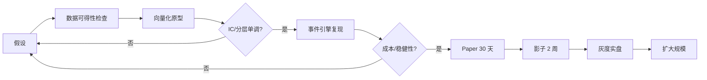

# 05 · 策略研究与回测方法论

> 本章回答一个问题：**在这套约束下，什么样的策略才可能赚钱？**
> 结论先行：成本（往返 2–20 bp）、延迟（部分市场 15 分钟）、只能市价单，三者共同决定——**高频做市、盘口套利、秒级抢单全部不可行**；可行的是"分钟到日级、多市场分散、严格控成本"的中频组合。

---

## 1. 约束 → 策略空间的映射

| 市场 | 往返成本 | 行情延迟 | 交易时段 | 可用策略类型 | 不可用 |
|---|---|---|---|---|---|
| 外汇 FX | **2 bp** | 0 | 24×5 | 趋势、carry、均值回归、事件 | 做市（无挂单） |
| 加密 Crypto | 20 bp | 0 | 24×7 | 趋势突破、波动率、跨币种截面 | 高频套利、三角套利 |
| 美股 | 10 bp | 0 | 21:30–04:00 | 动量、反转、开盘效应、指数成分 | 日内打板 |
| 港股 | 20 bp | **15 min** | 09:30–16:10 | 日级趋势、跨市场联动 | 分钟动量 |
| A股 | 20–26 bp | **15 min** | 09:30–15:00 | 日级反转、行业轮动 | 日内、打板 |
| 欧股 | 20 bp | 0 / 15 min 混合 | 15:00–23:30 | 日级动量、配对 | 分钟级 |
| 日股 | 20 bp | **15 min** | 08:00–14:30 | 日级、美股隔夜传导 | 日内 |
| 新交所 | 20 bp | **10 min** | 09:00–17:00 | 日级 | 日内 |
| 贵金属 | 10 bp | 0 | 美时段 | 趋势、宏观对冲 | 高频 |
| 指数 | 10 bp | 0 | 各市场 | 趋势、波动率、跨指数价差 | 成分套利 |

**成本门槛计算**（这是策略筛选的第一道闸）：

```
可交易条件：预期单笔收益 > 往返成本 × 安全系数(≥3)
外汇   : 需 > 6 bp 的单笔期望
美股   : 需 > 30 bp
港股/A股/日股/欧股/加密 : 需 > 60 bp
```

对应到持仓周期：日波动率 1.5% 的股票，单笔 60 bp 意味着**至少持有 2–3 天**或**做高胜率的均值回归**。这就是为什么本系统的主战场是**日级 + 跨市场**，而不是"高频"。

---

## 2. 策略族设计（3 族起步 + 2 族候选）

### 族 A：时序趋势 / 动量（Trend）

- **适用**：FX、Crypto、指数、贵金属（低成本 + 实时行情）。
- **假设**：分钟/小时级趋势在低成本品种上有持续性；加密的动量效应在 1–4 小时尺度显著。
- **信号**：
  ```
  mom_k = close_t / close_{t-k} − 1,  k ∈ {3, 6, 12, 24} 根 5m bar
  vol   = std(log_return, 72 bars)
  signal = Σ w_k · zscore(mom_k) / vol        # 波动率归一
  入场：signal > 1.5 且 vol < 80 分位；出场：|signal| < 0.5 或 反向穿越
  ```
- **风控**：ATR 止损（2×ATR）、时间止损（48 根 bar）、单笔风险 ≤ 权益 0.5%。
- **为什么可行**：FX 单边成本仅 2 bp，100 倍杠杆下保证金占用极低，可用高频调仓；crypto 虽 20 bp 但日波动 3–5%。

### 族 B：截面均值回归（Cross-sectional Mean Reversion）

- **适用**：同一交易所内的股票池（美股 518、A股 307、日股 225、港股 181）。
- **假设**：同市场同行业个股的短期相对强弱会回归；A股/日股散户结构导致反转更强。
- **信号**：
  ```
  r_5d  = 5 日收益
  score = −zscore(r_5d | industry)     # 行业内标准化
  多头前 20%，空头后 20%，行业中性，等权
  每日调仓，持有 3–5 日
  ```
- **风控**：行业暴露中性、单票 ≤ 5%、剔除流动性后 20%、剔除 close_only。
- **注意**：A股/日股有 15 分钟延迟 → 用**日线收盘信号 + 次日开盘执行**，不能在盘中交易。

### 族 C：配对 / 价差（Pairs & Spread）

- **适用**：同一 underlying 多挂牌、跨市场同质资产。
- **已验证的机会**：
  1. `EURONEXT:ASML` 与 `AMS:ASML` —— 同一公司在两个交易所报价，理论上价差应只反映汇率与流动性。
  2. `AMEX:GLD` 与 `INDEX:SPX` 的比价 —— 风险偏好切换的代理。
  3. **`fx_rate` 滞后套利**：RSC 价格 = `local_price × fx_rate`，`fx_rate` 若为固定/滞后换算率，当真实汇率波动时二者背离，可用 `FX:*` 对冲。
- **信号**：
  ```
  spread = log(P_a) − β·log(P_b),  β 用 60 日滚动回归
  z = (spread − μ_60d) / σ_60d
  开仓：|z| > 2；平仓：|z| < 0.5；止损：|z| > 3.5
  ```
- **风控**：协整检验（ADF p < 0.05）不过不入池；单对 ≤ 10%；两端同时下单，一端失败立即平另一端。
- **这是本系统最"像量化"的一族，也最需要 M3 的精确撮合模型。**

### 族 D（候选）：日历 / 事件

- 开盘缺口回补（美股、港股）、月末再平衡、宏观数据日 FX 波动率抬升。
- 需要事件日历数据源，M5 不排期，作为 backlog。

### 族 E（候选）：波动率目标 overlay

- 不是独立策略，而是**仓位调节器**：目标组合年化波动 10%，`w_t = min(1, target_vol / realized_vol_20d)`。
- 成本低、效果好，M5 必做（属于组合层而非策略层）。

---

## 3. 因子库

| 因子 | 定义 | 用途 | 预期方向 |
|---|---|---|---|
| `mom_k` | k 根 bar 收益 | 趋势 | + |
| `rev_1d/5d` | 短期反转 | 截面 | − |
| `vol_20/60` | 已实现波动 | 过滤/仓位 | − |
| `atr_14` | 真实波幅 | 止损距离 | — |
| `volume_z` | 成交量 z 分数 | 突破确认 | + |
| `spread_z` | 配对价差 z 分数 | 配对 | ± |
| `fx_dev` | `local_price×fx_rate` 与外部汇率隐含价差 | 汇率套利 | ± |
| `rel_strength` | 相对行业/指数强弱 | 截面 | ± |
| `session_flag` | 开盘后 N 分钟 | 择时 | — |
| `delay_flag` | 品种延迟标记 | 硬过滤 | — |

因子必须先过 **IC / ICIR / 分层单调性** 检验（`alphalens` 风格），再进策略。

---

## 4. 组合构建

```
1. 策略输出原始信号 → 目标权重 w_raw（每族内部归一）
2. 族间分配：风险平价（按族 60 日波动倒数），上限 50%/族
3. 约束投影：
   - 单标的 |w| ≤ 25%
   - 总名义杠杆 ≤ 3x（权益口径）
   - 同交易所 ≤ 60%
   - 相关性 > 0.8 的标的合并计算暴露
4. 波动率目标：整体缩放使组合 ex-ante vol = 10%
5. 执行：权重差分 → 订单意图 → 最小手数取整 → 风控
```

**资金约束**：账户 608 RSC。以 3x 杠杆计，最大名义 ~1800 RSC。股票最小 0.01 股（NVDA 约 2.1 RSC），意味着**一次最多持有 ~30–50 个股票仓位**，或把主力放在 FX/crypto（最小名义 1 RSC 以下）。组合构建必须内置"最小可交易单位"过滤。

---

## 5. 回测协议

### 5.1 双引擎

| 引擎 | 用途 | 精度 | 速度 |
|---|---|---|---|
| 向量化（Polars） | 因子筛选、参数扫描、大规模实验 | 近似（无撮合细节） | 秒级 |
| 事件驱动（engine.py） | 最终验收、上线前必跑 | 与实盘同构 | 分钟级 |

**规则**：任何策略上线前必须在事件引擎上复现向量化结果，偏差 > 20% 视为"向量化有前视偏差"，必须查清。

### 5.2 防前视偏差

- 信号只能用 `t` 时刻已知数据；`shift(1)` 强制检查。
- 延迟品种的信号额外 `shift(max(1, ceil(delay/bars)))`。
- 交易日历对齐，禁止用未来才收盘的 bar。
- 事件引擎用**虚拟时钟**，禁止读系统时间。

### 5.3 样本划分

```
|---- 训练 60% ----|-- 验证 20% --|- 测试 20%（只跑一次）-|
        ↑ walk-forward：每次滚动 3 个月，重训参数
```

- **Purged K-Fold**（López de Prado）：训练/测试间加 embargo = 持有期。
- 测试集只允许跑 **1 次**；跑第二次就要在报告里声明"已被污染"。

### 5.4 成本模型（必须校准）

```
总成本 = 手续费 + 滑点 + 冲击
手续费：fee_bps × 名义（实测：FX 1bp、美股 5bp、其余 10bp、部分 13/20bp）
滑点  ：N(μ, σ)，μ = 0，σ 从真实成交校准
冲击  ：k × sqrt(qty / ADV)，k 待标定
```

**校准数据**：账户已有 25 笔真实成交，含 `details.price` 与 `reference_price`。M3-T7 用它们拟合 σ：实测 BTC 两笔分别 −3.5 bp / −7.4 bp（相对参考价），说明**滑点是双向随机、量级 5 bp**。

### 5.5 评估指标

| 指标 | 公式/口径 | 门槛 |
|---|---|---|
| 年化收益 | `(1+r)^(252/n) − 1` | 报告 |
| Sharpe | `mean(r)/std(r)×√252`（**扣费后**） | > 0.8 |
| Sortino | 下行波动口径 | > 1.0 |
| Calmar | 年化收益 / MaxDD | > 0.5 |
| MaxDD | 权益曲线最大回撤 | < 20% |
| 胜率 / 盈亏比 | 按笔 | 报告 |
| 换手 | 名义/权益/日 | < 5× |
| 费用占比 | 总费用/毛利 | < 30% |
| 容量 | 策略规模翻倍后 Sharpe 衰减 | < 50% |

---

## 6. 研究流程（每个策略必须走完）



每步都有"不通过就回退"的明确条件，避免"先上线再优化"。

---

## 7. 防过拟合纪律

1. **参数数量 ≤ 自由度 1/10**：3 参数策略至少需要 30 个独立样本。
2. **只报告 walk-forward 结果**，不报告"全样本最优"。
3. **多重检验校正**：试验次数 N > 20 时，用 Deflated Sharpe Ratio 或 BH-FDR。
4. **参数高原**：最优参数周围 ±20% 必须仍为正（孤峰 = 过拟合）。
5. **跨市场验证**：在美股训练的动量，拿到欧股/日股是否仍有效。
6. **时间外推**：用 2024 训练 → 2025 验证 → 2026 测试，三段都要正。
7. **经济逻辑**：说不出"为什么这个溢价存在、谁在亏钱"的策略，一律不上。

---

## 8. 实验管理

每次实验记录到 `experiments.parquet`：

```
exp_id, ts, git_sha, data_version, config_hash,
universe, period, n_trades, sharpe, maxdd, calmar,
turnover, fee_ratio, notes, verdict(pass/fail/abandoned)
```

- `data_version` = 数据集的 DuckDB 快照哈希，保证可复现。
- 报告用固定模板（`research/report_template.md`），包含：假设、数据、信号、成本、结果、稳健性、结论、后续。

---

## 9. 针对"久留美活动"（FX）的专项设计

论坛在 2026-10-22 ~ 2026-12-17 举办 FX 活动（`fx-kurumi-2026`），费率 **1 bp**、杠杆 **100x**、6 个 featured 品种（JPY/EUR/GBP/AUD/CAD/CHF）。这是全站成本最低、最适合做量的市场。

专项规则：
- 杠杆使用受 `high_risk` 25% 权益预算约束，**不能无脑 100x**。
- 100x 下 1% 反向波动即亏掉全部保证金 → 必须 ATR 止损 + 硬性单笔风险 ≤ 0.3% 权益。
- 活动期间排行榜（`ranking.json?sort=pnl`）可作为相对基准，但不作为优化目标（避免为排名过度冒险）。

---

## 10. 收益预期管理（写给未来的自己）

- 608 RSC 本金、3x 杠杆上限、20 bp 成本，**现实目标**是月化 1–3%（年化 12–40%），且前 3 个月应以"验证方法论"为目标，不是赚钱。
- 任何声称"月化 20%+"的回测，先怀疑：是否用了未来数据、是否忽略滑点、是否样本内调参。
- 记录每一次"回测很美、实盘很惨"的原因，这是本项目最有价值的资产。
